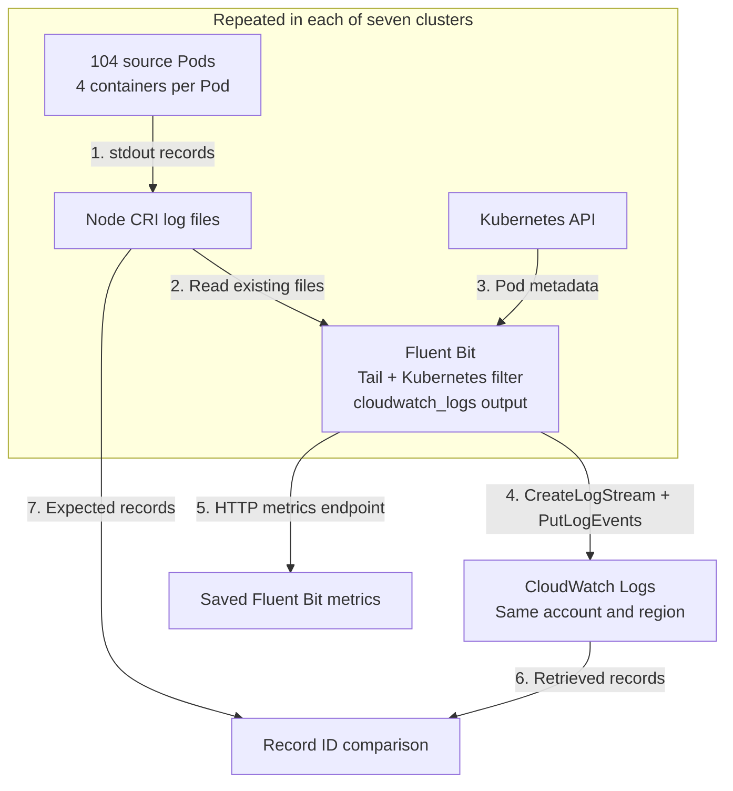
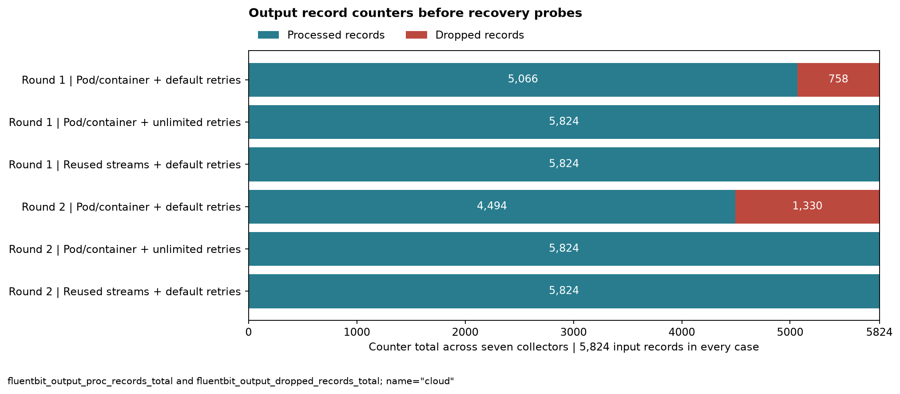
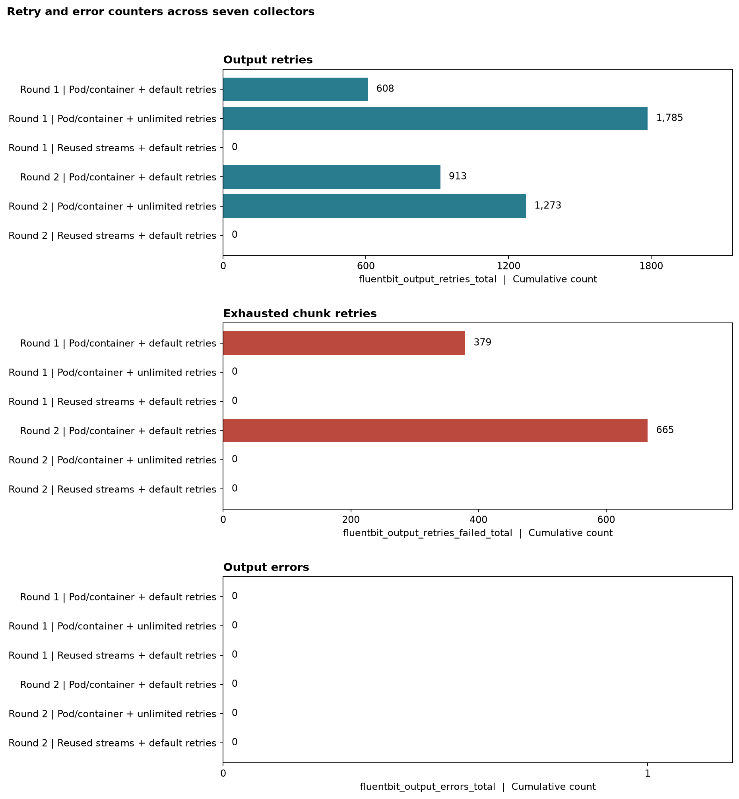
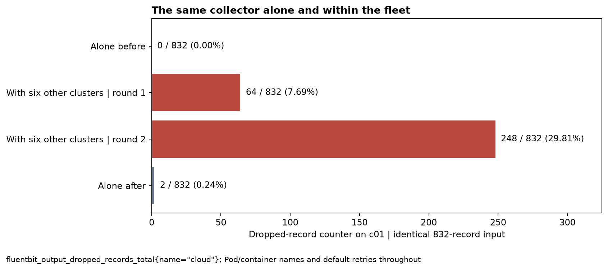

# Fluent Bit stream cardinality and delivery failures

## 1. Problem statement

Kubernetes logs can be separated into CloudWatch streams by Pod and container name. Log-stream cardinality is the number of distinct destinations selected by that naming configuration. Each new destination must be created before its records can be written. When many collectors are started together, stream-creation requests can be throttled even when little log data is being sent. The [request quota](https://docs.aws.amazon.com/AmazonCloudWatch/latest/logs/cloudwatch_limits_cwl.html) is shared by clusters using the same AWS account and region.

The effect of stream naming and retry settings was tested across seven EKS clusters. With Pod/container names and default output retries, 13.0% and 22.8% of records were discarded in two trials. With unlimited retries, every record was delivered, but some arrivals were delayed by more than eight minutes. With reused streams and default retries, every record was delivered within ten seconds in both trials.

These results were obtained from a fixed startup backlog. They are not estimates of production loss rates. Earlier lifecycle and simulated name-churn experiments are available in the [September 2026 archive](archive/2026-09/README.md).

## 2. Experiment setup

The experiment was run on 11 October 2026 in `us-west-2`. A single AWS account was used. The log groups were created before each trial so that stream creation could be tested separately from group creation.

| Component | Configuration |
|---|---|
| Kubernetes | Seven EKS 1.36 clusters |
| Workers | One `t3a.medium` per cluster: 2 vCPUs and 4 GiB memory |
| Network | One shared VPC, public subnets, no NAT gateways |
| Sources | 104 Pods per cluster, four containers per Pod |
| Records | Two JSON records per container; 728 Pods, 2,912 containers and 5,824 records per fleet trial |
| Collector | One Fluent Bit 5.1.3 Pod per cluster, native `cloudwatch_logs` output |
| Collection | Tail input, CRI parsing, Kubernetes metadata filter, 128 MiB input memory-buffer limit |
| Pod resources | No CPU or memory requests or limits on source, collector or test sidecar containers; system defaults retained |
| Destinations | A separate node/namespace log group per cluster and trial; a fresh stream cache and tail database per trial |
| Applied API quotas | `CreateLogStream`: 50 requests/second; `PutLogEvents`: 5,000 requests/second, each per account and region |

The same source files were read in all six fleet trials. After writing their two records, the source containers were left running. Collector startup was scheduled for the same timestamp across the fleet.

### Data flow



1. Two records with unique IDs were written to stdout by each source container. The records were stored in the node's CRI files.
2. Those files were read from the beginning by the Tail input after collector activation.
3. Pod and container metadata were added by the Kubernetes filter. Names from this metadata were used to select destinations.
4. Streams were created and records were sent by the output plugin. Failed chunks were retried according to the selected mode.
5. Prometheus-format counters were collected from `/api/v1/metrics/prometheus`. The root and enabled health endpoints were also checked.
6. Accepted records were retrieved from CloudWatch Logs after each trial.
7. Backend IDs were compared with the source-file IDs. Missing records, duplicates and recovery-probe records were checked separately from the Fluent Bit counters.

### Trial order

The three modes were run in this order: Pod/container names with default retries, the same names with unlimited retries, and reused streams with default retries. The order was reversed for the second round.

The selected cluster, c01, was also tested alone before and after the fleet comparisons. All other collectors were absent during these two baselines. The same 104 Pods and default-retry configuration were used. A separate eight-record recovery probe was sent through each collector after its backlog measurement had ended.

The load was increased from 100 to 102 and then 104 source Pods per cluster. The standard 110-Pod node limit was reached after system Pods, the collector and a recovery-probe slot were counted. No source restarts or out-of-memory kills were recorded. All seven clusters and their owned resources were removed after the experiment; 77 independent cleanup checks passed.

## 3. Tested modes and results

These are output-section excerpts. The [complete configurations](examples/fleet/README.md) include collection, metadata enrichment, group selection and metrics settings. Pod/container naming was selected explicitly; it is a documented example, not an automatic Kubernetes naming default.

### Pod and container names with default retries

Each source container was assigned a stream such as `data-0001.c0`. Up to 2,912 source destinations were needed across the fleet. Retry, worker and scheduler overrides were omitted.

```ini
[OUTPUT]
    Name cloudwatch_logs
    Alias cloud
    Match kube.*
    region us-west-2
    auto_create_group Off
    log_group_name ${CW_LOG_GROUP_PREFIX}/fallback
    log_group_template ${CW_LOG_GROUP_PREFIX}/$kubernetes['host'].$kubernetes['namespace_name']
    log_stream_prefix fallback-
    log_stream_template $kubernetes['pod_name'].$kubernetes['container_name']
```

The [default engine retry limit](https://docs.fluentbit.io/manual/administration/scheduling-and-retries) was one retry per failed chunk. That limit was exhausted for 379 chunks in round 1 and 665 in round 2. The corresponding dropped-record counters were 758 and 1,330. These missing IDs were also confirmed in the backend comparison.

### Pod and container names with unlimited retries

The same output configuration was used with one addition:

```ini
    Retry_Limit False
```

No records were discarded in either trial. Some records were accepted only after 8 minutes 18 seconds in round 1 and 8 minutes 9 seconds in round 2. These times were measured from scheduled collector activation to backend ingestion, including startup and tailing. The memory buffers were not tested through a collector or node failure.

### Reused streams with default retries

The stream prefix and template were replaced by a fixed stream name. The group template was unchanged, so one source stream was used per cluster's node/namespace group, seven across the fleet.

```ini
    log_stream_name reused
    # Retry_Limit was omitted.
```

Every source record was delivered in both trials, with no output retries or dropped records. The last records were ingested after 8.8 and 9.3 seconds. Pod and container metadata remained in each record, but individual sources had to be selected by filtering record fields rather than by opening a separate stream.

### Recorded Fluent Bit metrics

The figures below were generated from the raw Fluent Bit metric responses. Each bar is a cumulative counter total from fresh collector processes, summed across the seven collectors before recovery probes. No counter resets were found. The terminal snapshots were taken after the backlog had been processed or discarded; observation windows therefore differ between trials. The bars are counts, not rates.



`fluentbit_output_proc_records_total` counts records successfully processed by the output. It is not an independent count of unique backend records. In this experiment, it matched the separate ID comparison. `fluentbit_output_dropped_records_total` counts records discarded by the output route. Source files remained on the nodes until teardown.



`fluentbit_output_retries_total` counts scheduled output retries. `fluentbit_output_retries_failed_total` counts chunks abandoned after retry exhaustion. Neither is a count of CloudWatch API throttling responses. `fluentbit_output_errors_total` remained zero even in the two trials with discarded records.

### The same cluster alone and within the fleet



The c01 collector discarded 0 and 2 records when run alone, versus 64 and 248 when the other six collectors were active. Its input remained 832 records. Worse per-record outcomes were observed under the combined load. Cluster count, collector count and destination demand were increased together, so cluster count alone was not isolated as the cause.

### API and health checks

`CreateLogStream` throttling responses were found in the Pod/container trials. No `PutLogEvents` throttling responses were found in the saved collector logs. These observations came from API-response log lines, not from the counters plotted above.

The enabled `/api/v1/health` endpoint reported failures during both fleet default-retry trials. However, every captured health response was successful during the unlimited-retry trials despite their eight-minute delivery tails. Every health response was also successful in the final solo trial, in which two records were discarded. The root endpoint returned success throughout the captured observations.

## 4. Conclusion

Stream-creation demand was sufficient to cause record loss with default retries across this fleet, despite a small backlog of about 1.62 MB of source files. The result was affected by the rate of creation requests; the number of established streams alone was not tested as a cause.

Loss was replaced by delay when unlimited retries were configured. Both loss and retry activity were absent with reused streams in these trials, at the cost of source selection by record fields. Query cost, ordering and recovery after a crash were not measured.

Complete and timely delivery could not be established from the general output-error counter or a successful health response. The measured losses were recorded by the dropped-record and exhausted-retry counters. Backend arrival checks were used to establish delivery delay and completeness.

The [offline reproduction instructions](docs/FLEET_METHODS.md) cover raw metrics, synthetic record checks and figure regeneration. The [earlier experiment archive](archive/2026-09/README.md) remains available with its original evidence and scripts. Code, configurations, documentation, graphs and synthetic data are provided under [Apache License 2.0](LICENSE).
