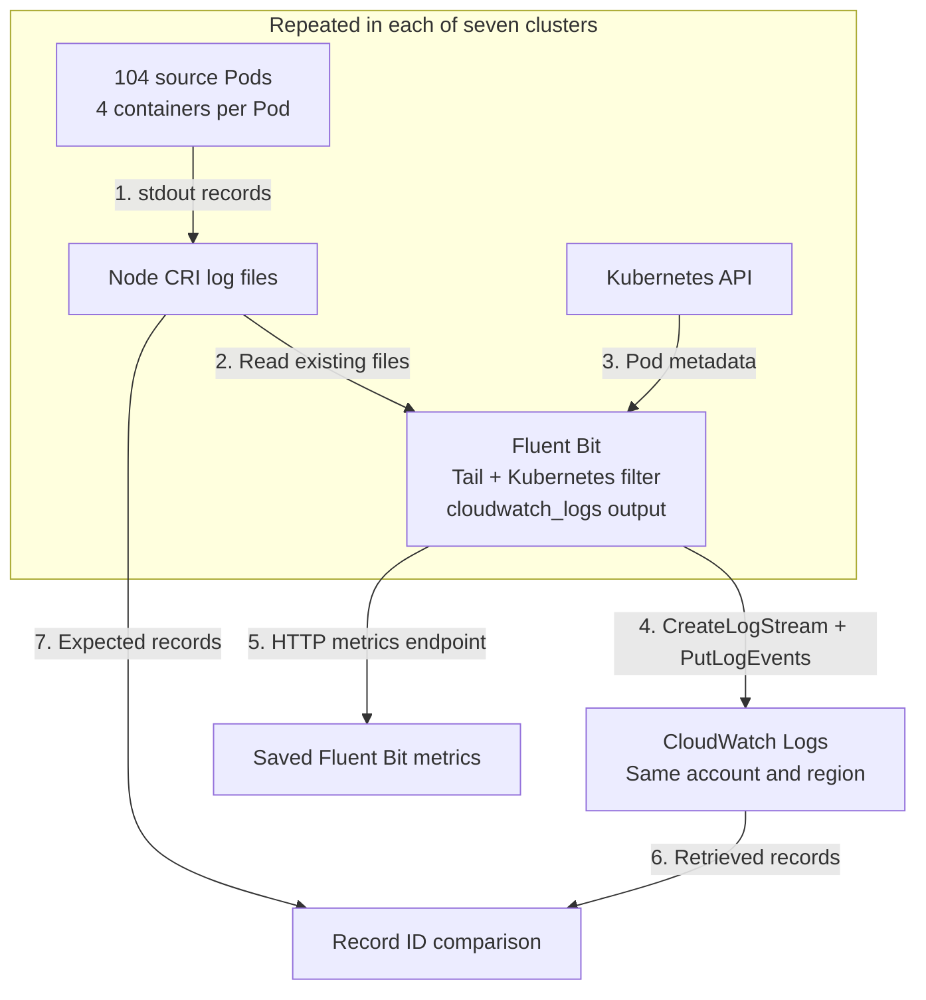

# Fluent Bit stream cardinality and delivery failures

## 1. Problem statement

Kubernetes logs can be sent to separate CloudWatch streams for each Pod and container. The number of distinct streams is called log-stream cardinality. Each new stream must be created before records can be written to it. When many collectors are started together, these creation requests can be throttled even at low log volumes. The [request quota](https://docs.aws.amazon.com/AmazonCloudWatch/latest/logs/cloudwatch_limits_cwl.html) is shared by clusters using the same AWS account and region.

Three combinations of stream names and retry settings were tested across seven EKS clusters. With Pod/container names and default output retries, 13.0% and 22.8% of records were discarded in two trials. With unlimited retries, every record was delivered, but some records were delayed by more than eight minutes. With reused streams and default retries, every record was delivered within ten seconds in both trials.

These results were obtained from a fixed startup backlog. They are not estimates of production loss rates. Earlier lifecycle and simulated name-churn experiments are available in the [September 2026 archive](archive/2026-09/README.md).

## 2. Experiment setup

The experiment was run on 11 October 2026 in one AWS account in `us-west-2`. Log groups were created before each trial to separate stream-creation failures from group creation.

| Component | Configuration |
|---|---|
| Kubernetes | Seven EKS 1.36 clusters |
| Workers | One `t3a.medium` per cluster: 2 vCPUs and 4 GiB memory |
| Network | One shared VPC, public subnets, no NAT gateways |
| Sources | 104 Pods per cluster, four containers per Pod |
| Records | Two JSON records per container; 728 Pods, 2,912 containers and 5,824 records per fleet trial |
| Collector | One Fluent Bit 5.1.3 Pod per cluster, native `cloudwatch_logs` output |
| Collection | Tail input, CRI parsing, Kubernetes metadata filter, 128 MiB input memory-buffer limit |
| Pod resources | No CPU or memory requests or limits on source, collector or test sidecar containers; system defaults retained |
| Destinations | A separate node/namespace log group per cluster and trial; a fresh stream cache and tail database per trial |
| Applied API quotas | `CreateLogStream`: 50 requests/second; `PutLogEvents`: 5,000 requests/second, each per account and region |

The same source files were read in all six fleet trials. After writing their two records, the source containers were left running. Collector startup was scheduled for the same timestamp across the fleet.

### Data flow



1. Two records with unique IDs were written to stdout by each source container. The records were stored in the node's CRI files.
2. Those files were read from the beginning by the Tail input after collector activation.
3. Pod and container metadata were added by the Kubernetes filter. Names from this metadata were used to select destinations.
4. Streams were created and records were sent by the output plugin. Failed chunks were retried according to the selected mode.
5. Prometheus-format counters were collected from `/api/v1/metrics/prometheus`. The root and enabled health endpoints were also checked.
6. Accepted records were retrieved from CloudWatch Logs after each trial.
7. Backend IDs were compared with the source-file IDs. Missing records, duplicates and recovery-probe records were checked separately from the Fluent Bit counters.

### Trial order

The three modes were run in this order: Pod/container names with default retries, the same names with unlimited retries, and reused streams with default retries. The order was reversed for the second round.

The selected cluster, c01, was also tested alone before and after the fleet comparisons. All other collectors were absent during these two baselines. The same 104 Pods and default-retry configuration were used. A separate eight-record recovery probe was sent through each collector after its backlog measurement had ended.

The load was increased from 100 to 102 and then 104 source Pods per cluster. The standard 110-Pod node limit was reached after system Pods, the collector and a recovery-probe slot were counted. No source restarts or out-of-memory kills were recorded. All seven clusters and their owned resources were removed after the experiment; 77 independent cleanup checks passed.

## 3. Tested modes and results

Output configuration excerpts are shown below. Collection, metadata enrichment, group selection and metrics settings are included in the [complete configurations](examples/fleet/README.md). Pod/container stream names were configured explicitly using the documented template syntax.

### Pod and container names with default retries

Each source container was assigned a stream such as `data-0001.c0`. Up to 2,912 source destinations were needed across the fleet. Retry, worker and scheduler overrides were omitted.

```ini
[OUTPUT]
    Name cloudwatch_logs
    Alias cloud
    Match kube.*
    region us-west-2
    auto_create_group Off
    log_group_name ${CW_LOG_GROUP_PREFIX}/fallback
    log_group_template ${CW_LOG_GROUP_PREFIX}/$kubernetes['host'].$kubernetes['namespace_name']
    log_stream_prefix fallback-
    log_stream_template $kubernetes['pod_name'].$kubernetes['container_name']
```

The [default engine retry limit](https://docs.fluentbit.io/manual/administration/scheduling-and-retries) was one retry per failed chunk. That limit was exhausted for 379 chunks in round 1 and 665 in round 2. Discarded records were counted as 758 and 1,330 by the dropped-record metric. The same numbers of missing records were confirmed by comparing source IDs with records retrieved from CloudWatch Logs.

### Pod and container names with unlimited retries

The same output configuration was used with one addition:

```ini
    Retry_Limit False
```

No records were discarded in either trial. Some records were accepted only after 8 minutes 18 seconds in round 1 and 8 minutes 9 seconds in round 2. These times were measured from scheduled collector activation to backend ingestion, including startup and tailing. The memory buffers were not tested through a collector or node failure.

### Reused streams with default retries

The stream prefix and template were replaced by a fixed stream name. The group template was unchanged, so one source stream was used per cluster's node/namespace group, seven across the fleet.

```ini
    log_stream_name reused
    # Retry_Limit was omitted.
```

Every source record was delivered in both trials, with no output retries or dropped records. The last records were ingested after 8.8 and 9.3 seconds. Pod and container metadata remained in each record, but individual sources had to be selected by filtering record fields rather than by opening a separate stream.

### Recorded Fluent Bit metrics

The figures were generated from saved Fluent Bit metrics. Each bar shows a cumulative count summed across seven fresh collector processes, before recovery probes were sent. No counter resets were found. Final samples were taken after the backlog had been processed or discarded, so the observation periods differ between trials. Counts, rather than rates, are plotted.


`fluentbit_output_proc_records_total` counts records successfully processed by the output. It is not an independent count of unique backend records. In this experiment, it matched the separate ID comparison. `fluentbit_output_dropped_records_total` counts records discarded by the output route. Source files remained on the nodes until teardown.


`fluentbit_output_retries_total` counts scheduled output retries. `fluentbit_output_retries_failed_total` counts chunks abandoned after retry exhaustion. Neither is a count of CloudWatch API throttling responses. `fluentbit_output_errors_total` remained zero even in the two trials with discarded records.

### The same cluster alone and within the fleet


Of the 832 records read by c01 in each trial, 0 and 2 were discarded when it was tested alone, versus 64 and 248 when the other six collectors were active. Cluster count, collector count and stream-creation demand were increased together. The effect of cluster count alone was not tested.

### API and health checks

`CreateLogStream` throttling responses were found in the Pod/container trials. No `PutLogEvents` throttling responses were found in the saved collector logs. API responses were checked in these logs separately from the Fluent Bit counters.

Failures were reported by the enabled `/api/v1/health` endpoint during both fleet default-retry trials. Successful health responses were recorded throughout the unlimited-retry trials, even while some records were delayed by more than eight minutes. Only successful health responses were recorded in the final solo trial, in which two records were discarded. The root endpoint returned success in every captured response.

## 4. Conclusion

Records were discarded after retries were exhausted during stream-creation throttling, despite a source backlog of about 1.62 MB. This experiment tested concurrent requests to create streams. The effect of keeping a large number of existing streams was not tested.

With unlimited retries, all records were delivered, but some were delayed by more than eight minutes. With reused streams, all records were delivered within ten seconds and no output retries were recorded. Logs from individual Pods and containers could still be found by filtering their metadata in the shared streams. Query cost, ordering and recovery after a crash were not measured.

Dropped-record and exhausted-retry counters increased while the general output-error counter remained zero. Successful health responses were returned during delayed delivery. Delivery delay and completeness were checked using records retrieved from CloudWatch Logs.

The [offline reproduction instructions](docs/FLEET_METHODS.md) describe how to check the saved metrics and synthetic records and regenerate the figures. Code, configurations, documentation, graphs and synthetic data are provided under [Apache License 2.0](LICENSE).
