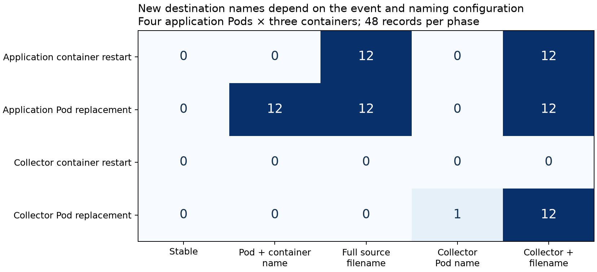
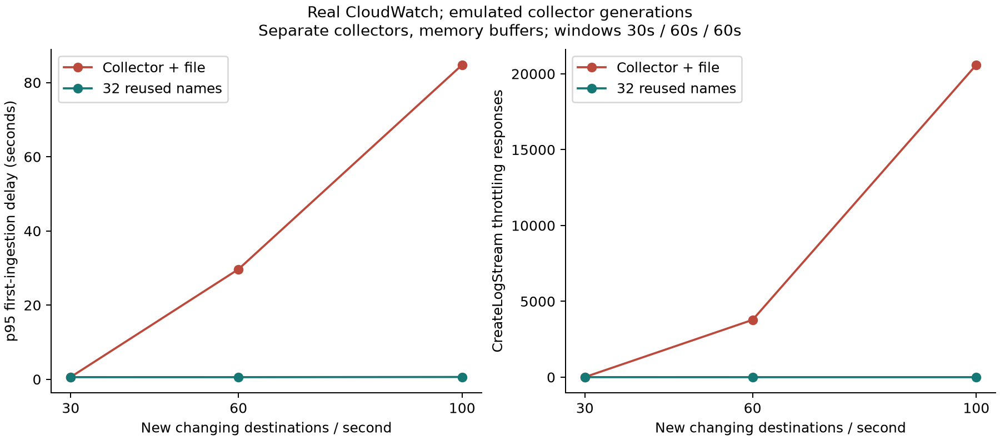
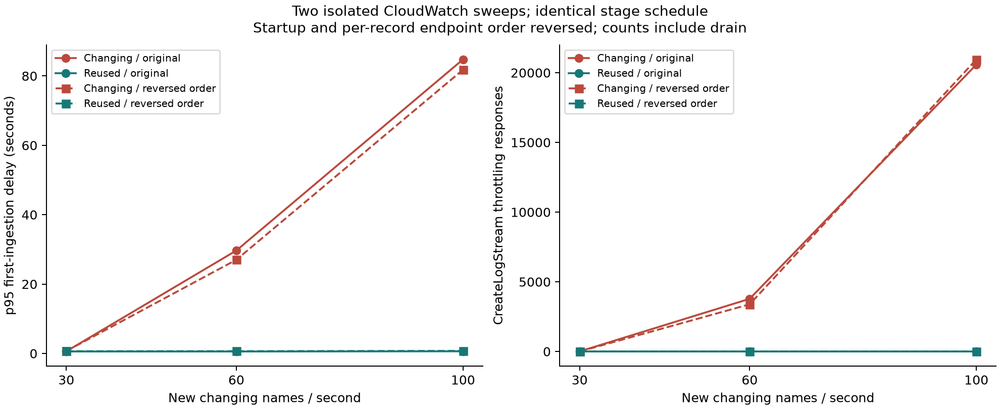

# Measured results and claim boundaries

Primary cloud run: `identity-cloud-20260915T022435Z`. Local lifecycle run: `identity-20260915T020624Z`. Evidence is compressed under `evidence/`; run the unpack command in the [README](README.md) to expand it into `results/` for analysis.

## Real Kubernetes mapping

Four one-container Pods and four three-container Pods each emitted 48 records per phase. The experiment audited 480 unique records over baseline and four lifecycle events. Application container restart preserved Pod UIDs and changed runtime container IDs; Pod replacement changed UIDs. Collector Pod replacement changed collector-plus-file names while application files stayed unchanged.

| Event | Stable | Pod + container name | Filename | Collector Pod name | Collector + filename |
|---|---:|---:|---:|---:|---:|
| Application container restart | 0 | 0 | 12 | 0 | 12 |
| Application Pod replacement | 0 | 12 | 12 | 0 | 12 |
| Collector container restart | 0 | 0 | 0 | 0 | 0 |
| Collector Pod replacement | 0 | 0 | 0 | 1 | 12 |

These are new computed names for the three-container variant, not AWS calls. Corresponding twelve-name changes were four in the single-container variant: 3×, or +200%, at fixed record count. Schemes are deliberate comparisons, not defaults. Controlled single restarts do not measure repeated crash-loop backoff. Tail offsets persisted and phases drained; log rotation and crash durability were excluded.

## Real CloudWatch, emulated collector generations

Two isolated local collectors, eight output workers each, memory buffers, identical payloads and host-side input schedule, twelve fixed captured filenames, synthetic collector generations. Per-source tags preserve file/generation boundaries. Region `us-west-2`; applied CreateLogStream quota 50/s. No actual collector replacements occur during this sweep.

| New changing names/s | Send window | Records/design | Changing creation throttles | Reused creation throttles | Changing p95 | Reused p95 |
|---|---:|---:|---:|---:|---:|---:|
| 30 | 30 s | 900 | 6 responses | 1 response | 0.618 s | 0.579 s |
| 60 | 60 s | 3,600 | 3,778 responses | 0 responses | 29.673 s | 0.576 s |
| 100 | 60 s | 6,000 | 20,586 responses | 0 responses | 84.763 s | 0.626 s |

Counts include send and drain. Delay uses earliest AWS ingestion timestamp minus host record-creation timestamp, including the local submission path. Reuse reduced p95 by 98.1% at 60/s and 99.3% at 100/s. Creation throttles occurred in every ten-second send bin at both above-quota rates. This supports sustained pressure over the tested minute, not an indefinite feedback loop. Below-average-quota startup still produced transient throttles.

AWS account/region metrics independently matched 34,903 creation calls and 24,371 throttles across both designs. Alias-attributed logs show 34,870 calls / 24,370 throttles for changing names and 33 calls / one throttle for reuse. AWS also returned 21,000 PutLogEvents calls; complete collector logs show no write throttles. Missing AWS throttle datapoints alone would not establish zero.

All 10,500 expected records arrived per design, with zero duplicate deliveries and exact payload/destination checks. The changing output recorded 24,370 retries while output errors, failed retries and dropped records remained zero. Monitoring and verification reads reported no errors. A running collector and zero terminal errors did not establish fresh delivery.

The table above preserves the original sweep. A completed repeat, `identity-cloud-20260916T011221Z`, reversed startup and per-record endpoint order while keeping both designs concurrent and demand stages unchanged:

| New changing names/s | Changing creation throttles | Reused creation throttles | Changing p95 | Reused p95 | Paired p95 reduction |
|---|---:|---:|---:|---:|---:|
| 30 | 0 responses | 0 responses | 0.704 s | 0.662 s | 6.0% |
| 60 | 3,384 responses | 0 responses | 27.006 s | 0.668 s | 97.5% |
| 100 | 20,955 responses | 0 responses | 81.798 s | 0.752 s | 99.1% |

All 10,500 records per design arrived in the repeat, without duplicates or payload/destination mismatches. AWS metrics matched 34,871 creation calls / 24,339 creation throttles across both designs and 21,000 PutLogEvents calls. Complete collector logs showed no write throttles. The changing output recorded 24,339 retries with zero output errors; neither collector restarted, and monitoring/verification reads reported no errors.

Every ten-second send bin at 60/s and 100/s had creation throttles in both runs. At 30/s, the repeat had none, unlike the original's small startup counts. The two 100/s comparisons give p95 ranges of 81.8–84.8 s versus 0.63–0.75 s and paired reductions of 99.1–99.3%. These are observed ranges, not pooled percentiles or confidence intervals.

## Supporting evidence and excluded comparisons

The real Deployment rollout test `rollout-20260915T005209Z` delivered 1,920 records per design. Pod-named inventory reached 96 streams; reuse occupied 30 of 32 possible partitions. An actual source filter retrieved all twenty expected records from a replaced Pod. No throttling occurred in that small run, so it validates collection/enrichment/lookup, not the stress threshold. Its record, retrieval and audit evidence is included.

Two included local stub cases show a no-failure control (A/B/C once each) and one late creation failure (A/B twice, C once) in a mixed-destination chunk. That conditional mechanism is not evidence that per-file cloud inputs inevitably duplicate records.

Earlier shared-process filesystem-buffer tests experienced coupled delay; one had incomplete diagnostic-log retention. The primary control changed both topology and storage mode, so it cannot attribute that difference to either change alone. A shared-tag exploratory test was interrupted and excluded. Their incomplete observations and the older stress test are not pooled with this headline comparison. This curated release contains selected completed evidence rather than the entire development history.

## Limits and cleanup

No measured production fleet, universal 50-name onset threshold, optimal partition count, exactly-once guarantee, query-cost improvement, or durable crash recovery is claimed. The fixed set needs initialization and a defined scope. Shared streams require retained metadata for source lookup; log groups can preserve policy/retention boundaries.

Original identity-run groups and the Kind cluster were independently absent at 2026-09-15 02:31:46 UTC. Cleanup evidence is included. No cloud compute was created for these identity runs. Cost estimates are not invoices, and account billing is deliberately excluded from this public package.

The repeat's group and namespace were removed, followed by its Kind cluster. Independent verification at 2026-09-16 01:19:33 UTC confirmed all identity-run groups and the owned cluster absent. The repeat uses the same tested container-image digests as the original. One preceding launch failed to locate kubectl before creating cloud resources and is excluded from measured results.
